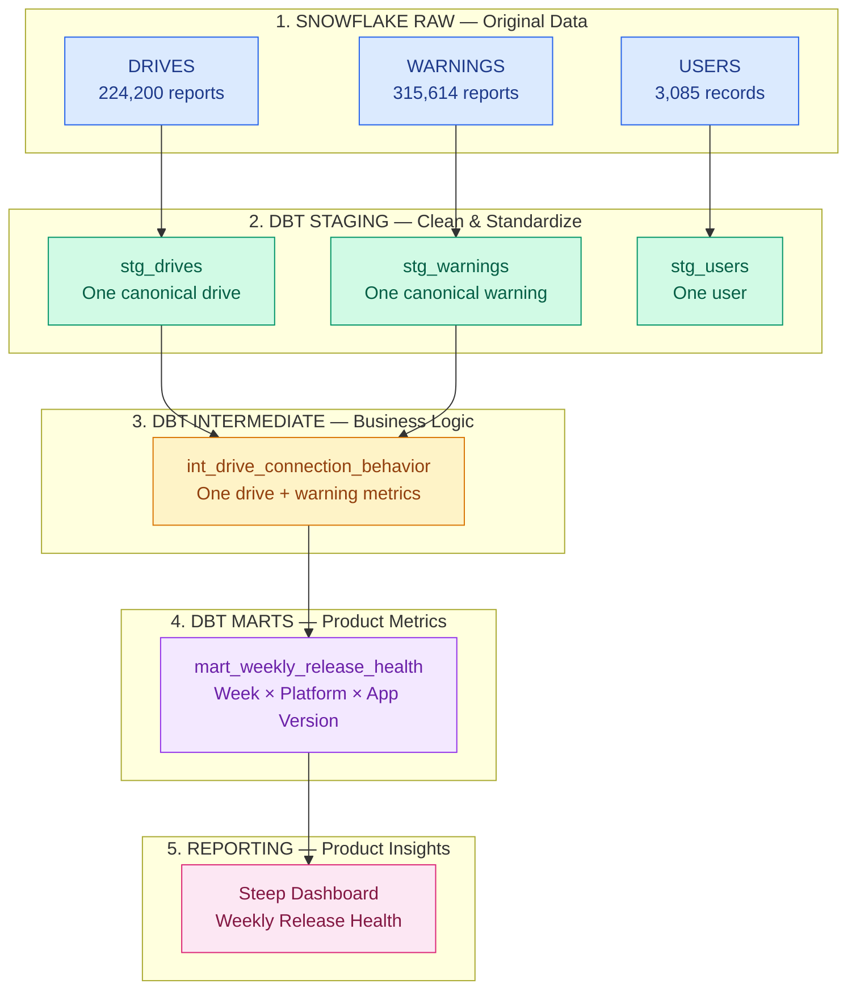

# dbt walkthrough

Read this from top to bottom. Each numbered step explains one part of our actual project.

**The goal:** turn original API reports in Snowflake RAW into trustworthy weekly release-health metrics. dbt transforms data already in Snowflake; Python handles API extraction and RAW ingestion.

## The data flow



The RAW counts shown are for the approved frozen baseline snapshot, not totals across every snapshot in RAW. The Steep dashboard is a planned reporting layer; it has not been implemented.

`stg_users` is available separately. Our current intermediate model and weekly mart do **not** join it.

## 1. Choose which data to analyze

Open [dbt_project.yml](../dbt/dbt_project.yml).

- `snapshot_id` chooses **one extraction snapshot** from RAW. New normal pipeline snapshots contain the previous drive/warning history plus new reports, so one snapshot can contain the accumulated history.
- `receipt_cutoff` limits drives and warnings to reports received by that moment. It controls which reports were available, not the reporting week of a drive.
- The checked-in defaults select the approved frozen baseline. A run can override them using `--vars`; new RAW snapshots do not automatically change these defaults.

## 2. Turn configuration values into SQL

Open [baseline.sql](../dbt/macros/baseline.sql).

- `snapshot_literal()` reads `var('snapshot_id')`, validates its format, and produces a quoted SQL value. `cutoff_literal()` reads `var('receipt_cutoff')` and produces a SQL timestamp value.
- These macros do **not** look up the latest snapshot in a table or save updated values. They use the values supplied for this dbt run.
- `monday(expression)` calculates the Monday for a date. `reference_baseline()` identifies the original snapshot/cutoff combination so historical reconciliation tests apply only to that baseline.

```text
dbt_project.yml defaults OR command-line --vars override
                         ↓
             baseline.sql reads var(...)
                         ↓
             SQL contains the chosen values
```

## 3. Locate the RAW tables

Open [_ooono__sources.yml](../dbt/models/staging/ooono/_ooono__sources.yml).

- This file tells dbt where the existing RAW tables live: the configured Snowflake database, schema `RAW`, and tables `DRIVES`, `WARNINGS`, and `USERS`.
- `source('ooono_raw', 'drives')` becomes the Snowflake table reference. It does not extract anything from the API.
- Each RAW row includes the original JSON in a `PAYLOAD` VARIANT column, plus metadata such as `SNAPSHOT_ID`, `SOURCE_ID`, and `SOURCE_RECEIVED_AT`, written by Python ingestion.

## 4. Select reports and collapse agreeing repeats

Open [agreed_records.sql](../dbt/macros/agreed_records.sql).

- `scoped` selects the configured snapshot and, for drives/warnings, applies the receipt cutoff. `identities` groups reports by `source_id` and compares payloads after removing only `received_at`.
- `agreed` keeps one representative report when all business fields agree: the earliest receipt, with `source_ordinal` breaking ties. It also carries `report_count`, `first_received_at`, and `last_received_at`; it does **not** sum connection counts or durations.
- Conflicting business versions and missing IDs do not enter the canonical output; blocking source tests expose them. Original RAW reports remain untouched. These named query steps are CTEs, not three new Snowflake tables.

Example: these are three reports of the same drive, not three drives.

| Session | Connection count | Received at | Result in staging |
|---|---:|---|---|
| A | 2 | 10:00 | Keep this representative |
| A | 2 | 10:05 | Collapse agreeing repeat |
| A | 2 | 10:10 | Collapse agreeing repeat |

The result is **one row: session A, connection_count = 2, report_count = 3**. All other business fields must also agree for this example to qualify.

## 5. Create `stg_drives`

Open [stg_drives.sql](../dbt/models/staging/ooono/stg_drives.sql).

- The model first calls `agreed_records('drives')`. It then extracts fields from `PAYLOAD`: session/user IDs, platform, app version, device, country, timestamps, duration, and connection count.
- It converts values to useful types using functions such as `TRY_TO_TIMESTAMP_NTZ` and `TRY_TO_DOUBLE`. Original timestamp and numeric strings, receipt summaries, and source lineage remain available.
- It flags parse errors, reversed intervals, future device clocks, invalid durations/counts, and duration mismatches. A flag preserves an issue for inspection; it does not silently delete that typed drive row.

**Grain:** one canonical session. **Storage:** a view in `STAGING`.

## 6. Create `stg_warnings`

Open [stg_warnings.sql](../dbt/models/staging/ooono/stg_warnings.sql).

- It calls `agreed_records('warnings')`, using `warning_id` as the identity. Different warning IDs from the same session remain separate events.
- It extracts session/user IDs, warning type (`pin_type`), user action, and device time, while retaining receipt metadata and lineage.
- It flags unparseable or suspicious future device times. Warnings without a matching drive remain in staging, where diagnostic tests can identify them.

**Grain:** one canonical warning. **Storage:** a view in `STAGING`.

## 7. Create `stg_users`

Open [stg_users.sql](../dbt/models/staging/ooono/stg_users.sql).

- It calls `agreed_records('users', false)`: the snapshot filter still applies, but the receipt cutoff does not. Users do not have the same source receipt timestamp as drive/warning reports.
- It extracts user ID, creation time, country, platform, plan, and monthly price, and flags creation-time parse errors.
- Each fresh extraction captures the full user list. This model represents users in the selected capture; it does not reconstruct historical plan changes or merge all user snapshots together.

**Grain:** one canonical user in the selected snapshot. **Storage:** a view in `STAGING`.

## 8. Build the drive-level intermediate model

Open [int_drive_connection_behavior.sql](../dbt/models/intermediate/int_drive_connection_behavior.sql).

- `matched_warnings` matches warnings to drives by `session_id` and checks their times and user IDs. `warning_totals` then counts warnings per session, including valid-interval warnings and anomaly counts.
- `enriched` left-joins those totals back to drives, so a drive with three warnings still produces **one drive row**, and a drive without warnings gets zero counts. It adds the Monday reporting week and `is_multi_connection = connection_count > 1`.
- `is_eligible` checks drive timestamp parsing, interval order, positive duration, valid connection count, and duration consistency. Warning anomalies stay visible and do not automatically exclude the drive; multi-connection is descriptive, not a confirmed failure.

**Grain:** one canonical drive with warning totals and analysis flags. **Storage:** a table in `STAGING`.

```text
Drive A + warning 1 ┐
Drive A + warning 2 ├─ count warnings first → Drive A | warning_count = 3
Drive A + warning 3 ┘
```

## 9. Build the weekly mart

Open [mart_weekly_release_health.sql](../dbt/models/marts/mart_weekly_release_health.sql).

- It selects eligible drives, excludes the current incomplete week, and excludes the known partial first source week. Drive start wall-calendar dates determine reporting weeks; the receipt cutoff in Copenhagen determines the current week boundary.
- It groups by week, platform, and app version, calculating eligible drives, multi-connection drives/share, distinct drivers, drivers with multiple connections, and supporting duration/warning metrics.
- It joins each group to the **immediately preceding week for the same platform and version** to calculate changes. If that prior group is absent, the comparison is null. Overall shares must use summed numerators divided by summed denominators, not an average of group shares.

**Grain:** reporting week × platform × app version. **Storage:** a table in `ANALYTICS`, intended for reporting in Steep.

## 10. Understand how dbt connects the pieces

- `ref('stg_drives')` means “use the dbt model named stg_drives.” These references define dependencies, letting dbt build upstream models before downstream models.
- `{{ ... }}` calls Jinja/dbt logic while compiling SQL. A macro is a reusable SQL-generating helper; a model is the SQL query dbt materializes as a view or table.
- [generate_schema_name.sql](../dbt/macros/generate_schema_name.sql) routes outputs to the exact `STAGING` and `ANALYTICS` schemas. It is a single-user case-study customization, not business metric logic.

## 11. Validate the result

Open [dbt/tests](../dbt/tests/) and the model YAML files alongside the SQL models.

- Tests check canonical IDs, source conflicts, drive/warning relationships, one-row-per-drive behavior, weekly grain, metric calculations, and week-over-week comparisons. A singular SQL test normally reports a problem when its query returns rows.
- Exact frozen-baseline reconciliation checks **219,848 canonical sessions** and the documented weekly platform numerators/denominators. Those fixed historical checks only apply when the original snapshot and cutoff are selected.
- Known warning clock anomalies and unmatched warnings generate warnings instead of stopping the entire build. Unexpected conflicts or metric inconsistencies remain blocking errors.

## Suggested reading order

1. `dbt_project.yml` — which data and output settings?
2. `baseline.sql` — how do configuration values become SQL?
3. `agreed_records.sql` — which original reports become canonical records?
4. `stg_drives.sql` — how does a report become typed columns and flags?
5. `stg_warnings.sql` and `stg_users.sql` — how do the other entities differ?
6. `int_drive_connection_behavior.sql` — how are warnings attached without duplicating drives?
7. `mart_weekly_release_health.sql` — how do drive rows become weekly metrics?
8. Tests — how do we verify those results?
